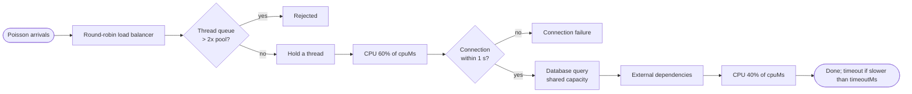

# The model

LoadTwin answers one question: *given what a load test measured on one environment, how will another environment behave under a given load?* It does so with a discrete-event simulation that is first calibrated to reproduce the measurement.

## 1. Request lifecycle

Each node has three SimPy resources: a **thread pool**, **CPU cores** and a **database connection pool**. The database itself can be a shared resource for the whole cluster.



- CPU time per request is lognormal (coefficient of variation about 0.5); database and external waits are lognormal too.
- When heap usage on a node exceeds 75%, CPU work is stretched to model garbage collection (up to about 1.6x at 95%).
- Background CPU (GC, scheduler, monitoring agents) occupies cores independently of requests.
- Warm-up: 10 s, measurement window: 60 s. Utilization is sampled every 0.25 s; the time series has 2 s buckets.

The error rate counts rejected requests, connection failures, timeouts and requests still queued at the end of the window, plus the measured baseline error rate.

## 2. Calibration

Input: load `λ`, CPU `u`, p95 and memory, measured on a spec with `v` vCPUs per node and `n` nodes.

1. **CPU per request**: `cpuMs = u × v × n × 1000 / λ`.
2. **Background split**: if this much CPU alone already pushes the simulated p95 above the measured p95, CPU per request is lowered (at most six steps) and the difference becomes background CPU, so total CPU still matches.
3. **Waits**: the combined database and external wait is found by bisection on a log scale between 2 ms and 20 s until the simulated p95 is within 5% of the measured p95. `waitShare` splits it between database and external dependencies.

Every calibration run uses the same seed so p95 moves monotonically with the wait. If the best fit is still more than 15% off, the verdict is `NOT_ASSESSABLE`.

## 3. Scaling to the target

Adding nodes adds capacity linearly, because the load balancer spreads requests evenly. Adding vCPUs per node does not: CPU time per request is multiplied by the Universal Scalability Law factor

```
cost(N) = 1 + α (N − 1) + β N (N − 1)      α = 0.03 (contention), β = 0.0002 (coherency)
factor  = cost(target vCPU) / cost(measured vCPU)
```

Going from 4 to 16 vCPUs per node multiplies CPU per request by about 1.37. When the target has more than 4x the measured CPU capacity, the result is flagged as a far extrapolation.

## 4. Capacity

At peak load, capacity is computed per resource and the smallest one bounds the cluster:

| Resource | Maximum load |
|---|---|
| CPU | `(vCPU × cpuLimit − background cores) × nodes × 1000 / cpuMs` |
| Thread pool | Little's Law: `threads × nodes / W`, with W the time a request holds a thread |
| Connection pool | `connections × nodes / W_db` |
| Network | `bandwidth × nodes × 90% / (payload × 2)` |
| Shared database | `maxConcurrentQueries × 80% / dbMs` |

Little's Law also gives the number of requests in flight at peak (`L = λW`) and a suggested thread pool size per node with 30% headroom.

## 5. Decision rules

Applied in order:

1. Calibration error above 15% → `NOT_ASSESSABLE`.
2. Any SLA violation at normal or peak load (p95, error rate, CPU, memory, or thread pool at 95% or more) → `FAIL`.
3. Target CPU capacity more than 4x the measured environment → `PASS_WITH_CONDITIONS`.
4. Highest utilization at peak above 75% → `PASS_WITH_CONDITIONS`.
5. Otherwise → `PASS`.

**Limiting resource** at peak: if p95 is violated while no resource is above 85% and most time is spent waiting, the dominant wait (database or external) is the limit. Otherwise it is the most utilized resource if that is at least 60%, else the resource that bounds capacity. On a tie between a saturated database and the connection pools behind it, the database wins.

6. With Monte Carlo replications: a breach probability of 50% or more → `FAIL`; above 5% turns a `PASS` into `PASS_WITH_CONDITIONS`.

## 6. Monte Carlo replications

A single run is one random draw of arrivals and service times. With `replications = N`, the peak scenario is simulated N times with independent seeds derived from the input (so the result is still reproducible). The breach probability is the share of runs that break any SLA limit; the response also gives breaches by cause and the min, p5, median, mean, p95 and max of p95, CPU and error rate across runs.

## 7. Auto-sizing

Calibration runs once on the measured environment. For each machine type in the catalog, the profile is rescaled with the USL for that vCPU count, and each node gets `vCPU × threadsPerVcpu` worker threads and the given connection pool. The search starts from the analytic node count `peak × cpuMs / (vCPU × CPU limit × 90% − background)`, walks up until the SLA holds, then down while it still holds (30-second measurement windows). That is the **minimal** configuration. The **comfortable** one adds up to four nodes until every resource is at or below 75% at peak; it stops early when the busiest resource is not one that more nodes relieve (memory per node, a shared database). Monthly cost is `hourly price × nodes × 730`. The recommendation is the cheapest comfortable configuration, or the cheapest minimal one when none is comfortable. When a shared database caps throughput below the peak (`maxConcurrentQueries × 80% / dbMs`), no search is run.

## 8. Load patterns

A pattern becomes back-to-back segments of constant rate: `daily` uses a fixed 24-hour business-day shape (each hour lasting `secondsPerHour`), `spike` is 60 s at base, the spike, then 90 s at base, `ramp` is ten equal steps, `custom` takes segments directly. Arrivals are Poisson within each segment, and the rate switches exactly at segment boundaries. Results are judged in 10-second windows on p95, error rate and CPU. Failures are counted in the window the request arrived in. Up to 5% of time in breach gives `PASS_WITH_CONDITIONS`; more gives `FAIL`. Recovery time is measured from the last drop of 20% or more in offered load until the first window that meets the SLA.

## 9. Load-test import and validation

- **k6**: `--summary-export` or `handleSummary` JSON, giving one point from `http_reqs.rate`, the p95 of `http_req_duration` and `http_req_failed`.
- **JMeter**: results CSV (`timeStamp`, `elapsed`, `success`), cut into 30-second windows; neighbouring windows within 15% of each other's load merge into one step.
- **Locust**: `*_stats_history.csv`, one point per `User Count` step, from the `Aggregated` rows.

Load tools do not record server CPU, so the user supplies it for at least one point. The model calibrates on that point (by default the one nearest the median load) and predicts p95 at every other point. The grade is the mean absolute p95 error over the other points: up to 10% `good`, up to 25% `fair`, above `poor`. The validated range spans the loads where the error is at most 25%.

## 10. Failure scenarios

A failure is active for a window in the middle of a run: 20 s healthy, the failure (10 to 120 s), then 30 s to recover, all at a constant load. The same run is simulated without the failure using the same seed, so differences come from the failure.

- **Node crash**: the load balancer stops routing to the crashed nodes immediately. Requests in flight on them are lost and counted as errors at the moment of the crash. CPU and pool utilization are computed over the nodes still up. The nodes return when the failure ends.
- **Slow database**: each query's time is multiplied while the failure is active (queue time at a shared database grows on top).
- **External dependency**: a share of external calls hangs for the client timeout and fails the request; or calls succeed but take longer.

Phases are judged on p95 and error rate of the requests that arrived in them. `PASS` when neither the failure nor the recovery breaks the SLA and no 10-second window does; `PASS_WITH_CONDITIONS` when the phases hold but some windows break; `FAIL` when the SLA breaks during the failure, or the recovery does not finish within 30 s.

## 11. Sensitivity analysis

At a given load, each input is moved down and up by the same relative step (25% by default; whole numbers move by at least one) while every other input stays the same, and the run is repeated with the same seed (common random numbers). Changing vCPU per node also changes CPU time per request through the scalability law. Inputs are ranked by the p95 swing between the two runs. Advice names the two changes that lower p95 the most, and the inputs that barely matter at that load.

## 12. Ask

A question becomes a plan: one of evaluate, fault, pattern or sensitivity, plus a load change, cluster changes, a failure or a pattern. With `LOADTWIN_LLM_API_KEY` set, a language model produces the plan through a tool call with a fixed schema; otherwise keyword rules do (English and Indonesian). The plan is validated and clamped to the API limits before it runs. The language model's explanation sees only a compact summary of the result and is rejected when it contains a number absent from the result, the plan or the question.

## 13. Limitations

- One measurement point calibrates the model (use Validate to check it against more). Behaviour far above the measured load, especially where locks or caches change regime, is extrapolated; the far-extrapolation rule only partly guards against it.
- The USL coefficients are generic defaults, not fitted to your service.
- Arrivals are Poisson within each segment. Correlated bursts, client retries and circuit breakers are not modelled, so failure scenarios may be optimistic when clients retry aggressively.
- A single service is modelled. Downstream services appear only as an external wait time.
- Memory is modelled as baseline plus per-request usage; leaks and batch jobs exist in the engine but are not yet exposed in the API.

Treat the output as a well-reasoned estimate to be confirmed with a load test, not as a replacement for one.
